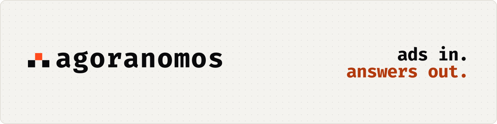
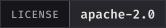
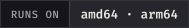
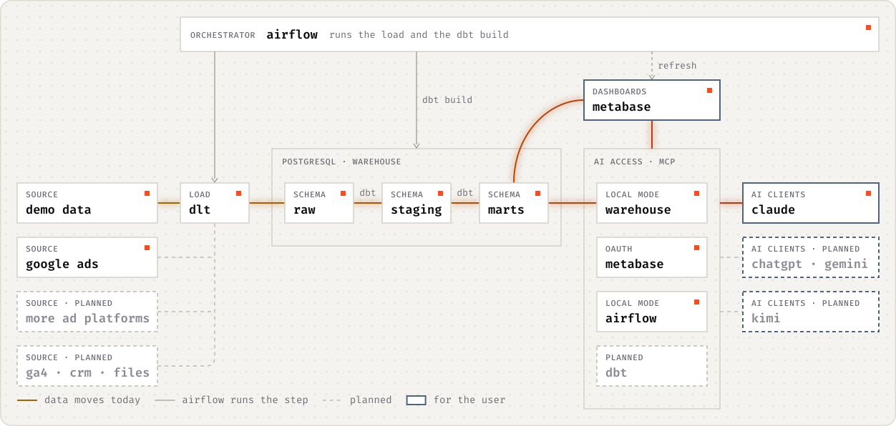

<p align="center">
  <picture>
    <source media="(prefers-color-scheme: dark)" srcset="docs/assets/readme/hero-dark.svg">
    
  </picture>
</p>

<p align="center">
  <b>Open-source marketing BI out of the box.</b><br>
  The goal: ad platforms → a PostgreSQL warehouse of your own → Metabase dashboards → questions in Claude or ChatGPT through MCP.<br>
  Today: one command, <code>./agoranomos up</code>, starts the stack and two demo dashboards on your machine. Your data stays yours.
</p>

<p align="center">
  <a href="#status-and-roadmap"></a>
  <a href="LICENSE"></a>
  <a href="docs/reference/system-requirements.md"></a>
  <a href="docs/explanation/architecture.md"></a>
</p>

<p align="center">
  <a href="#quick-start"><b>Quick start</b></a> ·
  <a href="docs/how-to/see-the-demo.md"><b>Demo</b></a> ·
  <a href="docs/explanation/architecture.md"><b>Architecture</b></a> ·
  <a href="docs/adr/index.md"><b>Decisions</b></a> ·
  <a href="#status-and-roadmap"><b>Roadmap</b></a> ·
  <a href="README.ru.md"><b>Русский</b></a>
</p>

> [!WARNING]
> **Pre-alpha.** Local mode and server mode, with its backups, run from the latest release, and the demo goes end to end, from a demo source to a dashboard. AI access runs: the MCP servers of Metabase, of the warehouse and of Airflow, the skills for coding agents and the guide [Talk to your data](docs/how-to/talk-to-your-data.md). The connectors to real sources come next.

<p align="center">
  <picture>
    <source media="(prefers-color-scheme: dark)" srcset="docs/assets/readme/demo-dashboard-dark.png">
    
  </picture>
</p>
<p align="center"><sub>The demo dashboard, which the first start builds from a demo source through dlt, dbt and Metabase. No accounts or keys needed.</sub></p>

## Why Agoranomos

AI assistants can already reach ad platforms through connectors to their live APIs. That works for a one-off question, and it leaves three gaps:

| No history of your own | No common model | No dashboards |
|---|---|---|
| A live API shows the data as the platform holds it today. Nothing is stored on your side, so there is nothing to compare against when the platform restates numbers as attribution matures. | Each platform has its own names, metrics, currencies and time zones. Without one model across platforms, the same question can get a different answer each time it is asked. | An answer in a chat is not a dashboard that a whole team can open every morning. |

Agoranomos is meant to close these gaps: it keeps the history in a warehouse you own, models the data once, puts dashboards on top and gives AI clients access to the modeled data instead of the raw platform APIs.

## How it works

<p align="center">
  <picture>
    <source media="(prefers-color-scheme: dark)" srcset="docs/assets/readme/pipeline-dark.svg">
    
  </picture>
</p>

Data moves in one direction, from ad platforms to dashboards and AI clients, and every step is code that runs on infrastructure you control. The diagram is the target design. Solid lines show what runs today: the colored ones carry data, and the thin gray ones are Airflow starting a step. Dashed lines are planned, and components arrive release by release.

| Step | Tool | What it does |
|---|---|---|
| **Load** | [dlt](https://dlthub.com/) | Pulls data from ad platform APIs, web analytics, CRM systems and files into PostgreSQL. The planned sources include Google, Meta, TikTok, Microsoft Advertising, LinkedIn and GA4. Today only the demo runs: it needs no accounts or keys and loads 18 months of synthetic statistics of a fictional business, on four fictional platforms in the shapes of the APIs of Google Ads, Meta, TikTok and GA4. |
| **Transform** | [dbt Core](https://docs.getdbt.com/) | Turns the raw tables into one unified model of advertising statistics, with a description of every model and column and tests that guard the marts. Today it builds that model from the demo, with money in the currency of each ad account and in one reporting currency: [The data model](docs/reference/data-model.md) describes its marts, such as `ad_stats_campaign_daily`. |
| **Orchestrate** | [Apache Airflow](https://airflow.apache.org/) | Schedules the loads and the dbt build, and refreshes Metabase afterwards. Today the demo runs this way: the first start loads the demo history once, a daily load brings each new day at 09:17 UTC, and the dbt build starts when each of the five sources has loaded. The refresh is planned. |
| **Explore** | [Metabase](https://www.metabase.com/) | Serves dashboards, metrics and a glossary from the final layer of the warehouse. Today there are the two dashboards of the demo and the dashboard of the Ops collection about the pipeline itself; metrics and a glossary are not built yet. |
| **Ask** | [MCP](https://modelcontextprotocol.io/) | AI clients reach the same data through MCP servers: the one built into Metabase, and servers for Airflow, the warehouse and dbt. Those of Metabase, Airflow and the warehouse shipped in v0.3.0, and that of dbt comes later ([Talk to your data](docs/how-to/talk-to-your-data.md)). An example question: "How much did we spend on each platform last week?" |

The [architecture overview](docs/explanation/architecture.md) describes every part, and the [decision records](docs/adr/index.md) say why each was chosen.

## Quick start

You need Docker with at least 6 GB of memory (8 GB recommended), git, and free ports 8080 and 3000 on `127.0.0.1`.

```bash
git clone https://github.com/agoranomos/agoranomos.git
cd agoranomos
./agoranomos up
```

`up` creates `.env` with new secrets, checks the machine, builds the Airflow image, starts the stack and waits until every service is healthy and the demo is ready. The first start takes a few minutes. Then:

| Service | Address | What to open |
|---|---|---|
| Metabase | <http://127.0.0.1:3000> | The collection **Agoranomos / Demo** and its dashboards **Advertising overview (demo)** and **Web analytics (demo)** |
| Airflow | <http://127.0.0.1:8080> | The DAGs `agoranomos_demo_history`, `agoranomos_demo_daily` and `agoranomos_demo_transform` |

`./agoranomos credentials` shows the addresses, the user names and the settings of `.env` that hold the passwords, and never prints a password; `./agoranomos down` stops the stack while the data stays. The tutorial [Run Agoranomos locally with demo data](docs/tutorials/run-locally-with-demo-data.md) walks through the demo step by step, and [Run Agoranomos locally](docs/how-to/run-locally.md) covers Windows, updates, memory and troubleshooting.

## Principles

- **Your data stays yours.** The warehouse is PostgreSQL on infrastructure you control, and the history stays there. Agoranomos needs no LLM account or key of its own: you use the AI client you already have, and it sees only what the MCP servers let it read. Whatever an AI client reads to answer a question is sent to that client's AI provider and handled under that provider's terms.
- **Least privilege by default.** Each MCP server is limited by its own control, so one mistake does not open everything. In Metabase, each deployment sets by levels how much AI clients may do, from running saved questions up to building dashboards with a BI developer; the dashboards of the package and the warehouse stay out of reach at every level ([ADR-0017](docs/adr/0017-set-ai-access-in-metabase-by-levels.md)). A new installation starts at the level `build`, and `./agoranomos ai set off` turns the built-in MCP server of Metabase off. In local mode, the MCP server of the warehouse reads the marts as a read-only role, and that of Airflow reads the pipelines and their logs and starts nothing; each has a switch of its own ([ADR-0030](docs/adr/0030-ship-three-mcp-servers-in-v0-3-0-with-the-stdio-servers-in-local-mode.md)). Campaign names and ad texts can carry instructions written by anyone, so Agoranomos treats them as untrusted data, and these limits reduce the damage if an AI client follows them anyway. See [ADR-0007](docs/adr/0007-ai-access-via-mcp-read-only.md).
- **Local and server modes.** Local mode is for engineers on their own machine, with ports published on `127.0.0.1` only. Server mode is for teams and for business users who connect from AI apps such as Claude: Caddy puts Metabase on HTTPS, on ports 80 and 443 only, and Airflow stays behind an SSH tunnel ([ADR-0019](docs/adr/0019-open-only-metabase-in-server-mode.md), [Deploy on a server](docs/how-to/deploy-on-a-server.md)). The `ops` profile backs up the databases every day ([ADR-0020](docs/adr/0020-back-up-the-databases-every-day.md), [Back up and restore](docs/how-to/back-up-and-restore.md)), and AI clients reach the Metabase MCP server over HTTPS with OAuth ([ADR-0011](docs/adr/0011-local-and-server-modes.md), [Talk to your data](docs/how-to/talk-to-your-data.md)).
- **amd64 and arm64, in 8 GB.** Both architectures are supported targets, Apple Silicon included. 8 GB of RAM available to Docker is recommended (12 GB for the CeleryExecutor variant) and 6 GB is the minimum, and every service has a memory limit measured on the demo ([System requirements](docs/reference/system-requirements.md), [ADR-0010](docs/adr/0010-multi-arch-and-memory-budget.md), [ADR-0022](docs/adr/0022-budget-the-memory-by-variant-and-mode.md)).

## Who it is for

- **Implementers**: analysts, freelancers, small agencies and data engineers who set up marketing analytics for their clients or for themselves. They get a stack of standard open-source parts that they can read, change and run, documentation to maintain it without its author, and every significant decision recorded in the open. Their coding agents work with the stack through MCP servers: Claude Code with the `.mcp.json` and the skills of the repository, and other agents, such as Cursor and Codex, through the same commands, which are not checked with them yet.
- **Business owners and marketers**, who want to see in one place what their advertising delivers across all platforms, and to ask about it in plain language in the AI app they already use, without writing SQL. They get Agoranomos through a specialist who runs it for them, or through a hosted version that is planned for later.

## Status and roadmap

| Phase | Release and status | What it delivers |
|---|---|---|
| 0. Foundation | none<br>✅ Done | The name, repository, license and structure, the tooling (uv, ruff, prek), the CI and documentation skeletons, and the first architecture decision records. |
| 1. Platform | v0.1.0<br>✅ Released | A Docker Compose stack with two PostgreSQL instances, Airflow 3.3 (the LocalExecutor by default; the CeleryExecutor variant adds a Valkey broker and a separate worker) and Metabase, in local and server modes, both covered by CI (server mode adds Caddy with automatic TLS and scheduled backups); secrets initialization; preflight checks; every service healthy, with a smoke test in CI; and one path end to end on demo data: a demo source (dlt) → raw → dbt (through Cosmos) → marts → a Metabase dashboard created from code. Local mode, server mode, the backups and the demo path run today, and server mode has been checked on a real server (a Hetzner Cloud CAX21, with a certificate of Let's Encrypt, in October 2026). Phase 1 was released as v0.1.0 on 11 October 2026. |
| 2. Data model on demo data | v0.2.0<br>✅ Released | The full demo generator, with four fictional platforms in the shapes of real APIs, a source of exchange rates and a daily load; the unified model of advertising statistics in marts; two demo dashboards, of the advertising and of web analytics, with filters; the Ops collection, with a dashboard about the health of the pipeline that elementary records; and the tutorial "Run Agoranomos locally with demo data". Phase 2 was released as v0.2.0 on 21 October 2026. |
| 3. AI layer | v0.3.0<br>✅ Released | Three MCP servers: the Metabase MCP server over HTTPS with OAuth for the Claude apps and other remote clients (ChatGPT is not checked yet), and, in local mode, MCP Toolbox and the Airflow MCP server; database roles; a ready-made `.mcp.json`; skills for coding agents; and the guide "Talk to your data". dbt-mcp, the fourth server, comes in a later release ([ADR-0030](docs/adr/0030-ship-three-mcp-servers-in-v0-3-0-with-the-stdio-servers-in-local-mode.md)). Phase 3 was released as v0.3.0 on 28 October 2026, the first public release, together with the documentation site, <https://agoranomos.dev>. Through the Claude apps, the MCP server of Metabase answers questions but cannot save them, as [Talk to your data](docs/how-to/talk-to-your-data.md#which-scopes-to-tick) explains. |
| 4. Real connectors | v0.4 and later<br>Planned | One data source per minor release, together with the unified model and FX rates. |
| 5. Operations | v0.x<br>Planned | Verified restores, an upgrade runbook, and more observability with elementary: its report, its tests of anomalies and its alerts. |
| Stable | v1.0.0<br>Planned | A stable contract for the configuration and the data models. |

The roadmap gives the order of the work, not dates. Versions are 0.x until the configuration and the data model are stable.

## Documentation

The documentation is Markdown in [`docs/`](docs/), built with [Zensical](https://zensical.org/) and organized after [Diátaxis](https://diataxis.fr/): tutorials, how-to guides, reference and explanation, plus the [architecture decision records](docs/adr/index.md). English is its primary language; this README is also [in Russian](README.ru.md), and the key pages are to follow.

| Page | What it covers |
|---|---|
| [Run Agoranomos locally with demo data](docs/tutorials/run-locally-with-demo-data.md) | A first tour: start the stack, read the demo dashboards and trace their data to the pipeline |
| [Architecture overview](docs/explanation/architecture.md) | What each part does and how they fit together |
| [Run Agoranomos locally](docs/how-to/run-locally.md) | Start, stop, update and troubleshoot the stack |
| [Deploy on a server](docs/how-to/deploy-on-a-server.md) | Put Metabase on the internet over HTTPS, with daily backups |
| [Back up and restore](docs/how-to/back-up-and-restore.md) | Take, schedule and copy backups, and restore them |
| [See the demo](docs/how-to/see-the-demo.md) | What the first start builds and where to look at it |
| [Talk to your data](docs/how-to/talk-to-your-data.md) | Connect Claude or another AI client through MCP, and keep a session safe |
| [Command line](docs/reference/command-line.md) and [Configuration](docs/reference/configuration.md) | Every command of `./agoranomos` and every setting of `.env` |

The site, <https://agoranomos.dev>, describes the latest release and is published with each one. To read the documentation of the main branch, use [uv](https://docs.astral.sh/uv/): run `uv sync` and `uv run zensical serve`, then open <http://localhost:8000>.

## Contributing

[CONTRIBUTING.md](CONTRIBUTING.md) describes how to set up the environment, how to make a change (Conventional Commits, DCO sign-off) and how significant decisions are recorded. Everyone who takes part follows the [Code of Conduct](CODE_OF_CONDUCT.md). Report security vulnerabilities privately, as [SECURITY.md](SECURITY.md) describes. AI coding agents should read [AGENTS.md](AGENTS.md).

## License

Agoranomos is licensed under the [Apache License 2.0](LICENSE). The third-party software that the stack runs keeps its own licenses. The Fira Sans and Fira Code fonts of the documentation site, in `docs/assets/fonts/`, are under the SIL Open Font License 1.1, and the license texts are next to them: [Fira Sans](docs/assets/fonts/OFL-FiraSans.txt) and [Fira Code](docs/assets/fonts/OFL-FiraCode.txt). Mermaid, which draws the diagrams of the documentation site, is served from `docs/assets/javascripts/` under the MIT License, and its license text is next to it: [Mermaid](docs/assets/javascripts/LICENSE-mermaid.txt). The Code of Conduct is adapted from the Contributor Covenant 3.0 and is licensed under [CC BY-SA 4.0](https://creativecommons.org/licenses/by-sa/4.0/).

## About the name

The name comes from the *agoranomoi* (singular: *agoranomos*), the market officials of ancient Athens. They made sure that the goods on sale were genuine and unadulterated (Aristotle, [*Constitution of the Athenians*, chapter 51](https://www.perseus.tufts.edu/hopper/text?doc=Perseus%3Atext%3A1999.01.0046%3Achapter%3D51)). Agoranomos tries to do the same for marketing numbers: one way of measuring every platform, and code that anyone can read, so that you can check that the numbers you rely on are genuine.

<br>

<p align="center">
  <picture>
    <source media="(prefers-color-scheme: dark)" srcset="docs/assets/readme/mark-dark.svg">
    
  </picture>
  <br>
  <sub><b>ads in. answers out.</b></sub>
</p>
