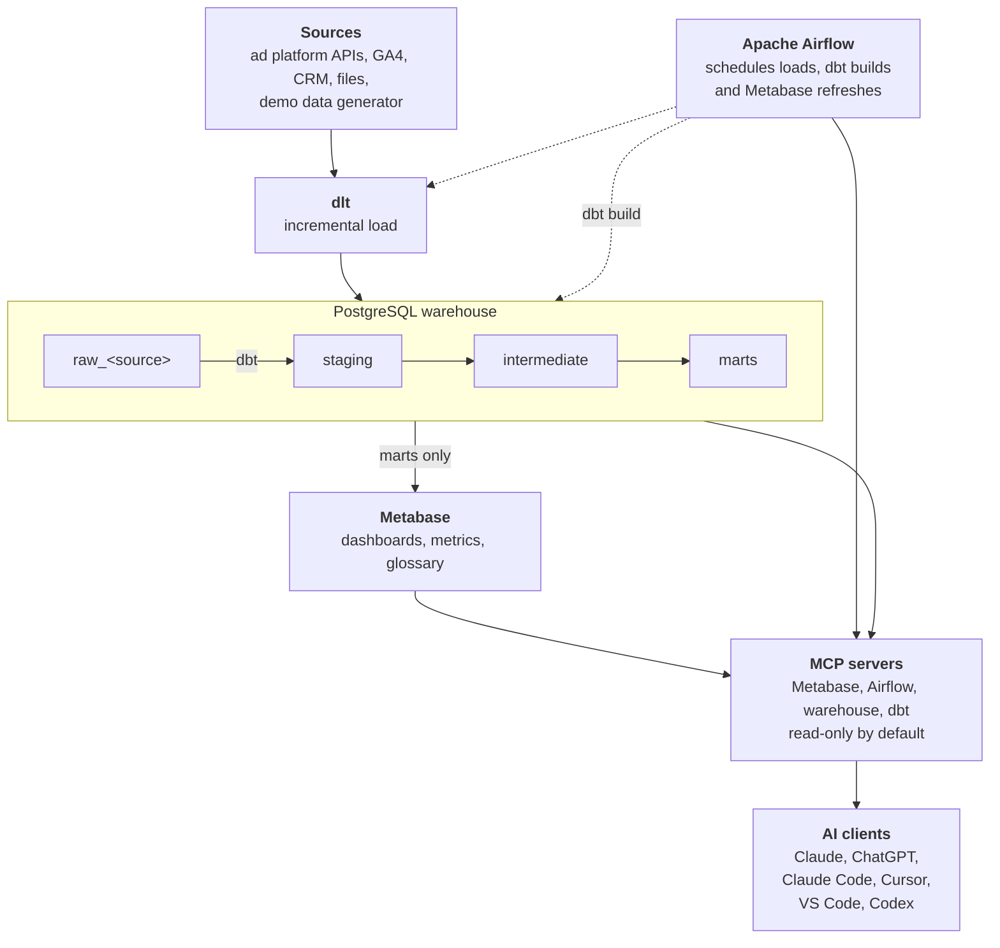

# Agoranomos

English | [Русский](README.ru.md)

Open-source marketing BI out of the box: ad platforms → PostgreSQL warehouse → Metabase dashboards → ask anything in Claude or ChatGPT via MCP. One command. Your data stays yours.

> [!WARNING]
> **Status: pre-alpha.** Agoranomos is under active development, and nothing in it is runnable yet. The repository is private until v0.3. What exists today is the project's tooling and its design: the [architecture overview](docs/explanation/architecture.md) and the [decision records](docs/adr/index.md). See [Status and roadmap](#status-and-roadmap).

## What it is

Agoranomos is a marketing analytics stack that you run on your own infrastructure. It is being built to:

- **Load** data from ad platforms, web analytics, CRM systems and files into a PostgreSQL warehouse that you own, on a schedule.
- **Model** that data with dbt into one view of advertising performance across all platforms.
- **Show** it in Metabase, with dashboards, metrics and a glossary that come ready-made.
- **Answer questions** asked in AI clients such as Claude and ChatGPT, through [MCP](https://modelcontextprotocol.io/) servers that are read-only by default. For example: "How much did we spend on each platform last week?"

It is designed to start with a single command, on a laptop or on a small server.

## Who it is for

Two doors lead into the same stack.

- **Business owners and marketers** who want to see what their advertising delivers across all platforms in one place, and to ask about it in plain language in the AI app they already use, without writing SQL, and from a phone when the stack runs on a server.
- **Data and analytics engineers** who want a stack of standard open-source parts (Apache Airflow, dlt, dbt Core, PostgreSQL and Metabase) that they can read, change and run themselves, with every significant decision recorded in the open. They also want their coding agents, such as Claude Code, Cursor and Codex, to inspect pipelines, query the warehouse and work with dbt models through MCP servers. Access is limited by default: read-only for pipelines and the warehouse, and a separate development target for dbt.

## The problem it solves

AI assistants can already reach advertising platforms directly, through connectors to their live APIs. That works for a one-off question, but it leaves three gaps:

- **No history of your own.** A live API shows the data as the platform holds it today. Nothing is stored on your side, so there is nothing to compare against when the platform restates numbers, as it does while attribution matures.
- **No common model.** Each platform has its own names, metrics, currencies and time zones. Without one model across platforms, the same question can get a different answer each time it is asked.
- **No dashboards.** An answer in a chat is not a dashboard that a whole team can open every morning.

Agoranomos is meant to close these gaps: it keeps the history in a warehouse you own, models the data once, puts dashboards on top and gives AI clients access to the modeled data instead of the raw platform APIs.

## How it works

Data moves in one direction, from ad platforms to dashboards and AI clients, and every step is code that runs on infrastructure you control. This is the target design: components arrive release by release, as the [roadmap](#status-and-roadmap) shows.



Solid arrows show how data moves. Dotted arrows show what Airflow runs.

1. **Load.** [dlt](https://dlthub.com/) pulls data from ad platform APIs, web analytics, CRM systems and files into PostgreSQL. The planned sources include ad platforms such as Google, Meta, TikTok, Yandex and VK, and GA4. A demo data generator, which needs no accounts or keys, is planned as well.
2. **Transform.** [dbt](https://docs.getdbt.com/) turns the raw tables into one unified model of advertising statistics.
3. **Orchestrate.** [Apache Airflow](https://airflow.apache.org/) schedules the loads and the dbt build, and refreshes Metabase afterwards.
4. **Explore.** [Metabase](https://www.metabase.com/) serves dashboards, metrics and a glossary from the final layer of the warehouse.
5. **Ask.** AI clients reach the same data through MCP servers: the one built into Metabase, and servers for Airflow, the warehouse and dbt.

The design rests on a few principles:

- **Your data stays yours.** The warehouse is PostgreSQL on infrastructure you control, and the history stays there. Agoranomos needs no LLM account or key of its own: you use the AI client you already have, and it sees only what the MCP servers let it read. Whatever an AI client reads to answer a question is sent to that client's AI provider and handled under that provider's terms.
- **Read-only by default.** Each MCP server is limited by its own control, so one mistake does not open everything. Campaign names and ad texts can carry instructions written by anyone, so Agoranomos treats them as untrusted data, and read-only access limits the damage if an AI client follows them anyway. See [ADR-0007](docs/adr/0007-ai-access-via-mcp-read-only.md).
- **Local and server modes.** Local mode is for engineers on their own machine: ports are published on `127.0.0.1` only. Server mode is for teams and for business users who connect from the Claude and ChatGPT apps: a reverse proxy with TLS sits in front of the web endpoints, the Metabase MCP server is served over HTTPS with OAuth, and backups run on a schedule. See [ADR-0011](docs/adr/0011-local-and-server-modes.md).
- **amd64 and arm64.** Both architectures are supported targets, Apple Silicon included, within a memory budget meant for a host with 8 GB of RAM. The figures are targets that have not been measured yet. See [ADR-0010](docs/adr/0010-multi-arch-and-memory-budget.md).

## Status and roadmap

Agoranomos is **pre-alpha**. Phase 0, the foundation, is in progress: the repository has its tooling, CI, documentation skeleton and the first decision records. Nothing is runnable yet, and the repository is private until v0.3.

| Phase | Release | What it delivers |
|---|---|---|
| 0. Foundation | none | The name, repository, license and structure, the tooling (uv, ruff, prek), the CI and documentation skeletons, and the first architecture decision records. In progress. |
| 1. Platform | v0.1.0 | A Docker Compose stack with two PostgreSQL instances, Valkey, Airflow 3.3 and Metabase, in local and server modes, both covered by CI (server mode adds Caddy with automatic TLS and scheduled backups); secrets initialization; preflight checks; every service healthy, with a smoke test in CI. |
| 2. End to end on demo data | v0.2.0 | A demo source (dlt) → raw → dbt (through Cosmos) → marts → Metabase dashboards created from code. |
| 3. AI layer | v0.3.0 | The four MCP servers, among them the Metabase MCP server over HTTPS with OAuth for the Claude and ChatGPT apps; database roles; a ready-made `.mcp.json`; skills for coding agents; and the guide "Talk to your data". The candidate for the first public release. |
| 4. Real connectors | v0.4 and later | One data source per minor release, together with the unified model and FX rates. |
| 5. Operations | v0.x | Verified restores, an upgrade runbook, and observability with elementary. |
| Stable | v1.0.0 | A stable contract for the configuration and the data models. |

The roadmap gives the order of the work, not dates. Versions are 0.x until the configuration and the data model are stable.

## Documentation

The documentation is Markdown in [`docs/`](docs/), built with [Zensical](https://zensical.org/) and organized after [Diátaxis](https://diataxis.fr/): tutorials, how-to guides, reference and explanation, plus the [architecture decision records](docs/adr/index.md). English is its primary language. The README is also available in Russian, and the key pages are to follow. Start with the [architecture overview](docs/explanation/architecture.md).

The site will be published when the repository goes public. Until then, read it locally. You need [uv](https://docs.astral.sh/uv/):

```bash
uv sync
uv run zensical serve
```

Then open <http://localhost:8000>.

## Contributing

[CONTRIBUTING.md](CONTRIBUTING.md) describes how to set up the environment, how to make a change (Conventional Commits, DCO sign-off) and how significant decisions are recorded. Everyone who takes part follows the [Code of Conduct](CODE_OF_CONDUCT.md). Report security vulnerabilities privately, as [SECURITY.md](SECURITY.md) describes. AI coding agents should read [AGENTS.md](AGENTS.md).

## License

Agoranomos is licensed under the [Apache License 2.0](LICENSE). The third-party software that the stack runs keeps its own licenses. The Code of Conduct is adapted from the Contributor Covenant 3.0 and is licensed under [CC BY-SA 4.0](https://creativecommons.org/licenses/by-sa/4.0/).

## About the name

The name comes from the *agoranomoi* (singular: *agoranomos*), the market officials of ancient Athens. They made sure that the goods on sale were genuine and unadulterated (Aristotle, [*Constitution of the Athenians*, chapter 51](https://www.perseus.tufts.edu/hopper/text?doc=Perseus%3Atext%3A1999.01.0046%3Achapter%3D51)). Agoranomos tries to do the same for marketing numbers: one way of measuring every platform, and code that anyone can read, so that you can check that the numbers you rely on are genuine.
