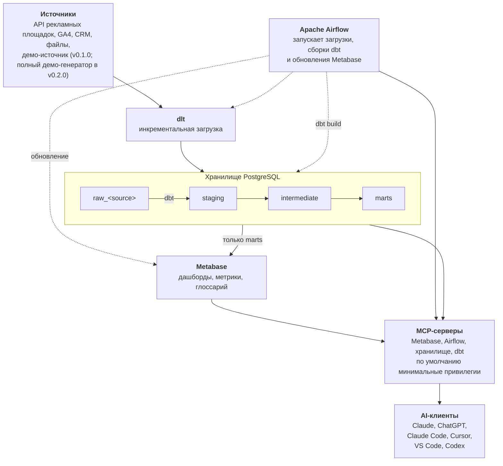

# Agoranomos

[English](README.md) | Русский

BI-система для маркетинга с открытым исходным кодом, которая работает «из коробки»: рекламные площадки → хранилище PostgreSQL → дашборды Metabase → любые вопросы в Claude или ChatGPT через MCP. Одна команда. Ваши данные остаются вашими.

> [!WARNING]
> **Статус: pre-alpha.** Agoranomos активно разрабатывается: стек запускается в локальном режиме из ветки main ([Run Agoranomos locally](docs/how-to/run-locally.md), на английском), а демо проходит весь путь — от демо-источника до дашборда. Серверный режим, резервные копии и коннекторы к настоящим источникам ещё строятся. Репозиторий приватный до версии v0.3. Замысел всего стека — в [обзоре архитектуры](docs/explanation/architecture.md) и [записях архитектурных решений](docs/adr/index.md) (обе страницы на английском). См. [Статус и дорожная карта](#статус-и-дорожная-карта).

## Что это

Agoranomos — это аналитический стек для маркетинга, который вы запускаете на собственной инфраструктуре. Его создают, чтобы он:

- **загружал** по расписанию данные рекламных площадок, веб-аналитики, CRM-систем и файлов в принадлежащее вам хранилище PostgreSQL;
- **моделировал** эти данные в dbt в единое представление рекламной эффективности по всем площадкам;
- **показывал** их в Metabase: дашборды, метрики и глоссарий поставляются готовыми;
- **отвечал на вопросы**, заданные в AI-клиентах вроде Claude и ChatGPT, через [MCP](https://modelcontextprotocol.io/)-серверы, которые по умолчанию получают минимально необходимые привилегии. Например: «Сколько мы потратили на каждую площадку на прошлой неделе?»

Запускать его задумано одной командой, на ноутбуке или на небольшом сервере.

## Для кого

- **Те, кто внедряет:** аналитики, фрилансеры, небольшие агентства и инженеры данных, которые настраивают маркетинговую аналитику клиентам или себе. Они получают стек из стандартных открытых компонентов (Apache Airflow, dlt, dbt Core, PostgreSQL и Metabase), который можно прочитать, изменить и запустить самим, документацию, по которой его можно поддерживать без автора, и каждое значимое решение, записанное в открытом виде. Их кодовые агенты, такие как Claude Code, Cursor и Codex, будут работать со стеком через MCP-серверы.
- **Владельцы бизнеса и маркетологи**, которые хотят видеть в одном месте, что даёт их реклама на всех площадках, и задавать вопросы обычным языком в привычном AI-приложении без SQL, в том числе с телефона, когда стек работает на сервере. Они получают Agoranomos через специалиста, который запускает и поддерживает его для них, или через облачную версию, которая пока только запланирована.

## Какую проблему решает

AI-ассистенты уже умеют обращаться к рекламным площадкам напрямую, через коннекторы к их живым API. Для разового вопроса этого достаточно, но остаются три пробела:

- **Нет собственной истории.** Живой API показывает данные в том виде, в каком площадка хранит их сегодня. У вас ничего не сохраняется, поэтому не с чем сравнивать, когда площадка пересчитывает цифры, а это происходит, пока созревает атрибуция.
- **Нет единой модели.** У каждой площадки свои названия, метрики, валюты и часовые пояса. Без единой модели по всем площадкам на один и тот же вопрос каждый раз можно получить другой ответ.
- **Нет дашбордов.** Ответ в чате не заменит дашборд, который вся команда открывает каждое утро.

Agoranomos создаётся, чтобы закрыть эти пробелы: хранить историю в вашем хранилище, один раз моделировать данные, строить поверх них дашборды и давать AI-клиентам доступ к смоделированным данным, а не к сырым API площадок.

## Как это устроено

Данные движутся в одном направлении, от рекламных площадок к дашбордам и AI-клиентам, и каждый шаг — это код, который работает на инфраструктуре под вашим контролем. Это целевая архитектура: компоненты появляются от релиза к релизу, как показывает [дорожная карта](#статус-и-дорожная-карта).



Сплошные стрелки показывают движение данных. Пунктирные показывают то, что запускает Airflow.

1. **Загрузка.** [dlt](https://dlthub.com/) забирает данные из API рекламных площадок, веб-аналитики, CRM-систем и файлов и складывает их в PostgreSQL. Среди запланированных источников есть рекламные площадки вроде Google, Meta, TikTok, Яндекса и VK, а также GA4. Демо-источник, которому не нужны ни аккаунты, ни ключи, загружает синтетическую статистику вымышленного рекламного аккаунта.
2. **Преобразование.** [dbt](https://docs.getdbt.com/) превращает сырые таблицы в единую модель рекламной статистики.
3. **Оркестрация.** [Apache Airflow](https://airflow.apache.org/) по расписанию запускает загрузки и сборку dbt, а затем обновляет Metabase.
4. **Исследование.** [Metabase](https://www.metabase.com/) отдаёт дашборды, метрики и глоссарий из финального слоя хранилища.
5. **Вопросы.** AI-клиенты обращаются к тем же данным через MCP-серверы: встроенный в Metabase, а также серверы для Airflow, хранилища и dbt.

В основе замысла несколько принципов:

- **Ваши данные остаются вашими.** Хранилище — это PostgreSQL на инфраструктуре под вашим контролем, и история хранится там же. Agoranomos не требует собственного аккаунта или ключа LLM: вы пользуетесь уже имеющимся AI-клиентом, а он видит только то, что ему позволяют читать MCP-серверы. Всё, что AI-клиент читает, чтобы ответить на вопрос, отправляется AI-провайдеру этого клиента и обрабатывается по правилам этого провайдера.
- **По умолчанию — минимальные привилегии.** Каждый MCP-сервер будет ограничен собственным механизмом, поэтому одна ошибка не откроет всё. Что именно может делать доступ AI-клиентов в каждом инструменте — например, читать хранилище, менять дашборды в Metabase или запускать пайплайны в Airflow, — определяется в ADR до выхода AI-слоя (фаза 3); до тех пор встроенный MCP-сервер Metabase выключен. Названия кампаний и тексты объявлений может написать кто угодно, и в них могут оказаться инструкции, поэтому Agoranomos считает их недоверенными данными, а эти ограничения уменьшают ущерб, если AI-клиент всё же последует таким инструкциям. См. [ADR-0007](docs/adr/0007-ai-access-via-mcp-read-only.md) (на английском).
- **Локальный и серверный режимы.** Локальный режим предназначен для инженеров на их собственной машине: порты публикуются только на `127.0.0.1`. Серверный режим предназначен для команд и для бизнес-пользователей, которые подключаются из приложений Claude и ChatGPT: перед веб-эндпоинтами стоит reverse proxy с TLS, MCP-сервер Metabase отдаётся по HTTPS с OAuth, а резервные копии делаются по расписанию. См. [ADR-0011](docs/adr/0011-local-and-server-modes.md) (на английском).
- **amd64 и arm64.** Обе архитектуры — целевые, включая Apple Silicon, в рамках бюджета памяти: рекомендуется 8 ГБ ОЗУ, доступных Docker, а минимум — 6 ГБ, чтобы стек помещался на хосте с 8 ГБ ОЗУ. Стек измерен на демо, и у каждого сервиса есть лимит памяти: см. [System requirements](docs/reference/system-requirements.md) и [ADR-0010](docs/adr/0010-multi-arch-and-memory-budget.md) (на английском).

## Статус и дорожная карта

Agoranomos находится на стадии **pre-alpha**. Фаза 0, фундамент, завершена: у репозитория есть инструменты, CI, каркас документации и первые записи архитектурных решений. Сейчас идёт фаза 1, платформа: локальный режим запускается из ветки main, а демо проходит весь путь — от демо-источника до дашборда; следующие — серверный режим, резервные копии и выпуск v0.1.0. Репозиторий приватный до версии v0.3.

| Фаза | Релиз | Что даёт |
|---|---|---|
| 0. Фундамент | нет | Название, репозиторий, лицензия и структура, инструменты (uv, ruff, prek), каркасы CI и документации и первые записи архитектурных решений. Завершена. |
| 1. Платформа | v0.1.0 | Стек на Docker Compose: два экземпляра PostgreSQL, Airflow 3.3 (по умолчанию с LocalExecutor; вариант с CeleryExecutor добавляет брокер Valkey и отдельный воркер) и Metabase, в локальном и серверном режимах, оба покрыты CI (серверный режим добавляет Caddy с автоматическим TLS и резервное копирование по расписанию); инициализация секретов; preflight-проверки; все сервисы в состоянии healthy, smoke-тест в CI; и один сквозной путь на демо-данных: демо-источник (dlt) → raw → dbt (через Cosmos) → marts → дашборд Metabase, созданный из кода. |
| 2. Модель данных на демо-данных | v0.2.0 | Полный демо-генератор с несколькими вымышленными площадками; единая модель рекламной статистики в marts; коллекция Ops с дашбордами о самом стеке. |
| 3. AI-слой | v0.3.0 | Четыре MCP-сервера, среди них MCP-сервер Metabase по HTTPS с OAuth для приложений Claude и ChatGPT; роли в базе данных; готовый `.mcp.json`; навыки (skills) для кодовых агентов; и руководство «Поговорите с данными». Кандидат на первый публичный релиз. |
| 4. Реальные коннекторы | v0.4 и позже | По одному источнику данных на минорный релиз, вместе с единой моделью и курсами валют. |
| 5. Эксплуатация | v0.x | Проверенное восстановление из резервных копий, руководство по обновлению и наблюдаемость на основе elementary. |
| Стабильная версия | v1.0.0 | Стабильный контракт конфигурации и моделей данных. |

Дорожная карта задаёт порядок работ, а не даты. Версии остаются 0.x, пока конфигурация и модель данных не станут стабильными.

## Документация

Документация — это Markdown в [`docs/`](docs/). Она собирается с помощью [Zensical](https://zensical.org/) и устроена по [Diátaxis](https://diataxis.fr/): туториалы, практические руководства (how-to), справочник и объяснения, плюс [записи архитектурных решений](docs/adr/index.md). Основной язык документации — английский. README переведён на русский, ключевые страницы будут переведены следом. Начните с [обзора архитектуры](docs/explanation/architecture.md). Чтобы запустить Agoranomos на своей машине, прочитайте [Run Agoranomos locally](docs/how-to/run-locally.md), а чтобы увидеть, что уже работает, — [See the demo](docs/how-to/see-the-demo.md) (обе страницы на английском).

Сайт будет опубликован, когда репозиторий станет публичным. До тех пор его можно читать локально. Понадобится [uv](https://docs.astral.sh/uv/):

```bash
uv sync
uv run zensical serve
```

Затем откройте <http://localhost:8000>.

## Участие в проекте

[CONTRIBUTING.md](CONTRIBUTING.md) (на английском) описывает, как подготовить окружение, как вносить изменения (Conventional Commits, подпись DCO) и как записываются значимые решения. Все участники соблюдают [Кодекс поведения](CODE_OF_CONDUCT.md) (на английском). О найденных уязвимостях сообщайте приватно, как описано в [SECURITY.md](SECURITY.md) (на английском). Кодовым AI-агентам стоит прочитать [AGENTS.md](AGENTS.md) (на английском).

## Лицензия

Agoranomos распространяется по лицензии [Apache License 2.0](LICENSE). Стороннее ПО, которое запускает стек, сохраняет собственные лицензии. Кодекс поведения адаптирован из Contributor Covenant 3.0 и распространяется по лицензии [CC BY-SA 4.0](https://creativecommons.org/licenses/by-sa/4.0/).

## Об имени

Название происходит от *агораномов* (*agoranomoi*; в единственном числе *agoranomos*), рыночных должностных лиц Древних Афин. Они следили, чтобы продаваемые товары были настоящими и не фальсифицированными (Аристотель, [«Афинская полития», глава 51](https://www.perseus.tufts.edu/hopper/text?doc=Perseus%3Atext%3A1999.01.0046%3Achapter%3D51), на английском). Agoranomos старается делать то же для маркетинговых цифр: единый способ измерения для всех площадок и код, который может прочитать любой, чтобы вы могли проверить, что цифры, на которые вы опираетесь, настоящие.
