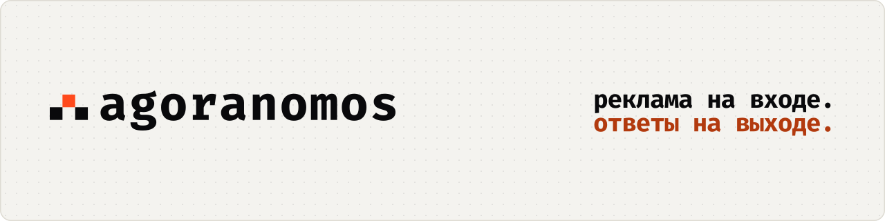
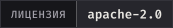
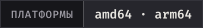
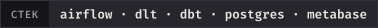
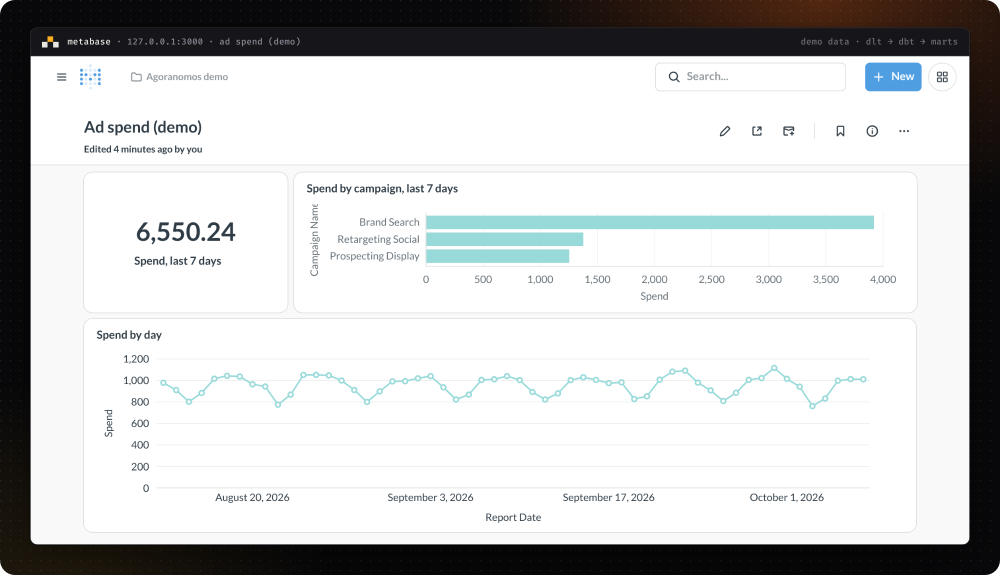
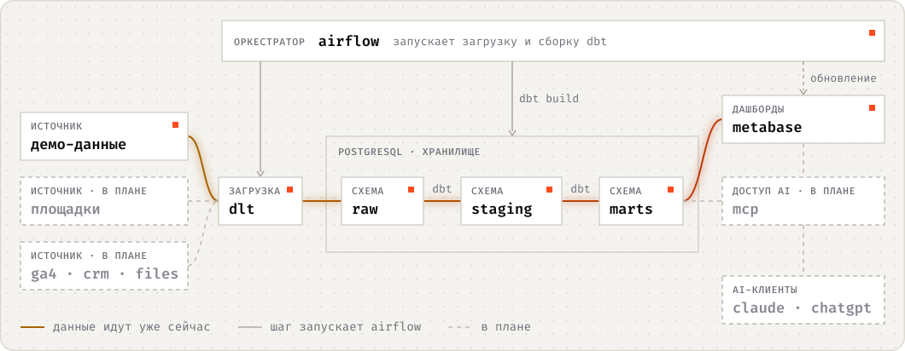

<p align="center">
  <picture>
    <source media="(prefers-color-scheme: dark)" srcset="docs/assets/readme/hero-ru-dark.svg">
    
  </picture>
</p>

<p align="center">
  <b>BI-система для маркетинга с открытым исходным кодом, которая работает «из коробки».</b><br>
  Цель: рекламные площадки → ваше собственное хранилище PostgreSQL → дашборды Metabase → вопросы в Claude или ChatGPT через MCP.<br>
  Сегодня: одна команда, <code>./agoranomos up</code>, запускает стек и два демо-дашборда на вашей машине. Ваши данные остаются вашими.
</p>

<p align="center">
  <a href="#статус-и-дорожная-карта"></a>
  <a href="LICENSE"></a>
  <a href="docs/reference/system-requirements.md"></a>
  <a href="docs/explanation/architecture.md"></a>
</p>

<p align="center">
  <a href="#быстрый-старт"><b>Быстрый старт</b></a> ·
  <a href="docs/how-to/see-the-demo.md"><b>Демо</b></a> ·
  <a href="docs/explanation/architecture.md"><b>Архитектура</b></a> ·
  <a href="docs/adr/index.md"><b>Решения</b></a> ·
  <a href="#статус-и-дорожная-карта"><b>Дорожная карта</b></a> ·
  <a href="README.md"><b>English</b></a>
</p>

> [!WARNING]
> **Pre-alpha.** Локальный режим и серверный режим с резервными копиями запускаются из последнего релиза, а демо проходит весь путь — от демо-источника до дашборда. Доступ AI-клиентов работает: MCP-серверы Metabase, хранилища и Airflow, навыки для кодовых агентов и руководство [Talk to your data](docs/how-to/talk-to-your-data.md) (на английском). Следующими будут коннекторы к настоящим источникам.

<p align="center">
  <picture>
    <source media="(prefers-color-scheme: dark)" srcset="docs/assets/readme/demo-dashboard-dark.png">
    
  </picture>
</p>
<p align="center"><sub>Демо-дашборд, который первый запуск строит из демо-источника через dlt, dbt и Metabase. Ни аккаунты, ни ключи не нужны.</sub></p>

## Зачем Agoranomos

AI-ассистенты уже умеют обращаться к рекламным площадкам через коннекторы к их живым API. Для разового вопроса этого достаточно, но остаются три пробела:

| Нет собственной истории | Нет единой модели | Нет дашбордов |
|---|---|---|
| Живой API показывает данные в том виде, в каком площадка хранит их сегодня. У вас ничего не сохраняется, поэтому не с чем сравнивать, когда площадка пересчитывает цифры, пока созревает атрибуция. | У каждой площадки свои названия, метрики, валюты и часовые пояса. Без единой модели по всем площадкам на один и тот же вопрос каждый раз можно получить другой ответ. | Ответ в чате не заменит дашборд, который вся команда открывает каждое утро. |

Agoranomos создаётся, чтобы закрыть эти пробелы: хранить историю в вашем хранилище, один раз моделировать данные, строить поверх них дашборды и давать AI-клиентам доступ к смоделированным данным, а не к сырым API площадок.

## Как это устроено

<p align="center">
  <picture>
    <source media="(prefers-color-scheme: dark)" srcset="docs/assets/readme/pipeline-ru-dark.svg">
    
  </picture>
</p>

Данные движутся в одном направлении, от рекламных площадок к дашбордам и AI-клиентам, и каждый шаг — это код, который работает на инфраструктуре под вашим контролем. На схеме целевая архитектура. Сплошные линии показывают то, что работает уже сейчас: цветные несут данные, а тонкие серые — это Airflow запускает шаг. Пунктир запланирован, а компоненты появляются от релиза к релизу.

| Шаг | Инструмент | Что делает |
|---|---|---|
| **Загрузка** | [dlt](https://dlthub.com/) | Забирает данные из API рекламных площадок, веб-аналитики, CRM-систем и файлов и складывает их в PostgreSQL. Среди запланированных источников есть Google, Meta, TikTok, Microsoft Advertising, LinkedIn и GA4. Сейчас работает только демо: ему не нужны ни аккаунты, ни ключи, оно загружает синтетическую статистику вымышленного бизнеса за 18 месяцев, на четырёх вымышленных площадках по образцу API Google Ads, Meta, TikTok и GA4. |
| **Преобразование** | [dbt Core](https://docs.getdbt.com/) | Превращает сырые таблицы в единую модель рекламной статистики, с описанием каждой модели и колонки и тестами, которые защищают marts. Сейчас он собирает эту модель из демо, с деньгами в валюте каждого рекламного аккаунта и в одной валюте отчётов: [The data model](docs/reference/data-model.md) (на английском) описывает её marts, например `ad_stats_campaign_daily`. |
| **Оркестрация** | [Apache Airflow](https://airflow.apache.org/) | По расписанию запускает загрузки и сборку dbt, а затем обновляет Metabase. Сейчас демо работает так: первый запуск один раз загружает историю демо, ежедневная загрузка в 09:17 UTC приносит каждый новый день, а сборка dbt начинается, когда загрузились все пять источников. Обновление Metabase запланировано. |
| **Исследование** | [Metabase](https://www.metabase.com/) | Отдаёт дашборды, метрики и глоссарий из финального слоя хранилища. Сейчас есть два дашборда демо и дашборд Ops-коллекции о работе самого пайплайна; метрики и глоссарий ещё не построены. |
| **Вопросы** | [MCP](https://modelcontextprotocol.io/) | AI-клиенты обращаются к тем же данным через MCP-серверы: встроенный в Metabase, а также серверы для Airflow, хранилища и dbt. Серверы Metabase, Airflow и хранилища вышли в v0.3.0, сервер dbt появится позже ([Talk to your data](docs/how-to/talk-to-your-data.md), на английском). Пример вопроса: «Сколько мы потратили на каждую площадку на прошлой неделе?» |

[Обзор архитектуры](docs/explanation/architecture.md) описывает каждую часть, а [записи архитектурных решений](docs/adr/index.md) объясняют, почему выбрана именно она (обе страницы на английском).

## Быстрый старт

Понадобятся Docker, которому доступно не меньше 6 ГБ памяти (рекомендуется 8 ГБ), git и свободные порты 8080 и 3000 на `127.0.0.1`.

```bash
git clone https://github.com/agoranomos/agoranomos.git
cd agoranomos
./agoranomos up
```

`up` создаёт `.env` с новыми секретами, проверяет машину, собирает образ Airflow, запускает стек и ждёт, пока все сервисы станут healthy, а демо будет готово. Первый запуск занимает несколько минут. Затем:

| Сервис | Адрес | Что открыть |
|---|---|---|
| Metabase | <http://127.0.0.1:3000> | Коллекцию **Agoranomos / Demo** и её дашборды **Advertising overview (demo)** и **Web analytics (demo)** |
| Airflow | <http://127.0.0.1:8080> | DAG `agoranomos_demo_history`, `agoranomos_demo_daily` и `agoranomos_demo_transform` |

`./agoranomos credentials` показывает адреса, имена пользователей и настройки `.env`, в которых лежат пароли, а сам пароль не печатает; `./agoranomos down` останавливает стек, данные при этом остаются. Туториал [Run Agoranomos locally with demo data](docs/tutorials/run-locally-with-demo-data.md) (на английском) шаг за шагом проводит по демо, а [Run Agoranomos locally](docs/how-to/run-locally.md) (на английском) рассказывает про Windows, обновления, память и решение проблем.

## Принципы

- **Ваши данные остаются вашими.** Хранилище — это PostgreSQL на инфраструктуре под вашим контролем, и история хранится там же. Agoranomos не требует собственного аккаунта или ключа LLM: вы пользуетесь уже имеющимся AI-клиентом, а он видит только то, что ему позволяют читать MCP-серверы. Всё, что AI-клиент читает, чтобы ответить на вопрос, отправляется AI-провайдеру этого клиента и обрабатывается по правилам этого провайдера.
- **По умолчанию — минимальные привилегии.** Каждый MCP-сервер ограничен собственным механизмом, поэтому одна ошибка не откроет всё. В Metabase каждая установка сама задаёт уровнями, сколько могут AI-клиенты: от запуска сохранённых вопросов до сборки дашбордов вместе с BI-разработчиком; дашборды из комплекта поставки и хранилище при этом не меняются ни на каком уровне ([ADR-0017](docs/adr/0017-set-ai-access-in-metabase-by-levels.md), на английском). Новая установка начинает с уровня `build`, а `./agoranomos ai set off` выключает встроенный MCP-сервер Metabase. В локальном режиме MCP-сервер хранилища читает витрины под ролью только для чтения, а MCP-сервер Airflow читает пайплайны и их логи и ничего не запускает; у каждого свой выключатель ([ADR-0030](docs/adr/0030-ship-three-mcp-servers-in-v0-3-0-with-the-stdio-servers-in-local-mode.md), на английском). Названия кампаний и тексты объявлений может написать кто угодно, и в них могут оказаться инструкции, поэтому Agoranomos считает их недоверенными данными, а эти ограничения уменьшают ущерб, если AI-клиент всё же последует таким инструкциям. См. [ADR-0007](docs/adr/0007-ai-access-via-mcp-read-only.md) (на английском).
- **Локальный и серверный режимы.** Локальный режим предназначен для инженеров на их собственной машине, порты публикуются только на `127.0.0.1`. Серверный режим предназначен для команд и для бизнес-пользователей, которые подключаются из AI-приложений, например Claude: Caddy открывает Metabase по HTTPS только на портах 80 и 443, а Airflow доступен через SSH-туннель ([ADR-0019](docs/adr/0019-open-only-metabase-in-server-mode.md), на английском; [Развернуть на сервере](docs/how-to/deploy-on-a-server.md), на английском). Профиль `ops` каждый день делает резервные копии баз ([ADR-0020](docs/adr/0020-back-up-the-databases-every-day.md), на английском; [Резервные копии и восстановление](docs/how-to/back-up-and-restore.md), на английском), а AI-клиенты подключаются к MCP-серверу Metabase по HTTPS с OAuth ([ADR-0011](docs/adr/0011-local-and-server-modes.md), на английском; [Talk to your data](docs/how-to/talk-to-your-data.md), на английском).
- **amd64 и arm64, в 8 ГБ.** Обе архитектуры — целевые, включая Apple Silicon. Рекомендуется 8 ГБ ОЗУ, доступных Docker (12 ГБ для варианта с CeleryExecutor), минимум — 6 ГБ, и у каждого сервиса есть лимит памяти, измеренный на демо ([System requirements](docs/reference/system-requirements.md), [ADR-0010](docs/adr/0010-multi-arch-and-memory-budget.md), [ADR-0022](docs/adr/0022-budget-the-memory-by-variant-and-mode.md), на английском).

## Для кого

- **Те, кто внедряет:** аналитики, фрилансеры, небольшие агентства и инженеры данных, которые настраивают маркетинговую аналитику клиентам или себе. Они получают стек из стандартных открытых компонентов, который можно прочитать, изменить и запустить самим, документацию, по которой его можно поддерживать без автора, и каждое значимое решение, записанное в открытом виде. Их кодовые агенты работают со стеком через MCP-серверы: Claude Code с готовым `.mcp.json` и навыками репозитория, а другие агенты, такие как Cursor и Codex, через те же команды, хотя с ними это еще не проверено.
- **Владельцы бизнеса и маркетологи**, которые хотят видеть в одном месте, что даёт их реклама на всех площадках, и задавать вопросы обычным языком в привычном AI-приложении без SQL. Они получают Agoranomos через специалиста, который запускает и поддерживает его для них, или через облачную версию, которая пока только запланирована.

## Статус и дорожная карта

| Фаза | Релиз и статус | Что даёт |
|---|---|---|
| 0. Фундамент | нет<br>✅ Завершена | Название, репозиторий, лицензия и структура, инструменты (uv, ruff, prek), каркасы CI и документации и первые записи архитектурных решений. |
| 1. Платформа | v0.1.0<br>✅ Выпущена | Стек на Docker Compose: два экземпляра PostgreSQL, Airflow 3.3 (по умолчанию с LocalExecutor; вариант с CeleryExecutor добавляет брокер Valkey и отдельный воркер) и Metabase, в локальном и серверном режимах, оба покрыты CI (серверный режим добавляет Caddy с автоматическим TLS и резервное копирование по расписанию); инициализация секретов; preflight-проверки; все сервисы в состоянии healthy, smoke-тест в CI; и один сквозной путь на демо-данных: демо-источник (dlt) → raw → dbt (через Cosmos) → marts → дашборд Metabase, созданный из кода. Локальный режим, серверный режим, резервные копии и демо-путь уже работают, а серверный режим проверен на настоящем сервере (Hetzner Cloud CAX21, с сертификатом Let's Encrypt, в октябре 2026). Фаза 1 выпущена как v0.1.0 11 октября 2026 года. |
| 2. Модель данных на демо-данных | v0.2.0<br>✅ Выпущена | Полный демо-генератор: четыре вымышленные площадки в форме настоящих API, источник курсов валют и ежедневная загрузка; единая модель рекламной статистики в marts; два демо-дашборда, по рекламе и по веб-аналитике, с фильтрами; коллекция Ops с дашбордом о здоровье пайплайна, который записывает elementary; туториал «Run Agoranomos locally with demo data». Фаза 2 выпущена как v0.2.0 21 октября 2026 года. |
| 3. AI-слой | v0.3.0<br>✅ Выпущена | Три MCP-сервера: MCP-сервер Metabase по HTTPS с OAuth для приложений Claude и других удаленных клиентов (ChatGPT пока не проверен) и, в локальном режиме, MCP Toolbox и MCP-сервер Airflow; роли в базе данных; готовый `.mcp.json`; навыки (skills) для кодовых агентов; и руководство «Поговорите с данными». dbt-mcp, четвёртый сервер, появится в одном из следующих релизов ([ADR-0030](docs/adr/0030-ship-three-mcp-servers-in-v0-3-0-with-the-stdio-servers-in-local-mode.md)). Фаза 3 вышла 28 октября 2026 года как v0.3.0, первый публичный релиз, вместе с сайтом документации <https://agoranomos.dev>. Через приложения Claude MCP-сервер Metabase отвечает на вопросы, но не может их сохранять: подробности в [Talk to your data](docs/how-to/talk-to-your-data.md#which-scopes-to-tick). |
| 4. Реальные коннекторы | v0.4 и позже<br>В плане | По одному источнику данных на минорный релиз, вместе с единой моделью и курсами валют. |
| 5. Эксплуатация | v0.x<br>В плане | Проверенное восстановление из резервных копий, руководство по обновлению и больше наблюдаемости на основе elementary: его отчёт, тесты аномалий и оповещения. |
| Стабильная версия | v1.0.0<br>В плане | Стабильный контракт конфигурации и моделей данных. |

Дорожная карта задаёт порядок работ, а не даты. Версии остаются 0.x, пока конфигурация и модель данных не станут стабильными.

## Документация

Документация — это Markdown в [`docs/`](docs/). Она собирается с помощью [Zensical](https://zensical.org/) и устроена по [Diátaxis](https://diataxis.fr/): туториалы, практические руководства (how-to), справочник и объяснения, плюс [записи архитектурных решений](docs/adr/index.md). Основной язык документации — английский. README переведён на русский (оригинал — [на английском](README.md)), ключевые страницы будут переведены следом.

| Страница | О чём |
|---|---|
| [Run Agoranomos locally with demo data](docs/tutorials/run-locally-with-demo-data.md) | Первое знакомство: запустить стек, посмотреть дашборды демо и проследить их данные до пайплайна |
| [Architecture overview](docs/explanation/architecture.md) | Что делает каждая часть и как они связаны |
| [Run Agoranomos locally](docs/how-to/run-locally.md) | Запуск, остановка, обновление и решение проблем |
| [Deploy on a server](docs/how-to/deploy-on-a-server.md) | Metabase в интернете по HTTPS, с ежедневными резервными копиями |
| [Back up and restore](docs/how-to/back-up-and-restore.md) | Резервные копии: создать, запланировать, скопировать и восстановить |
| [See the demo](docs/how-to/see-the-demo.md) | Что строит первый запуск и где на это посмотреть |
| [Talk to your data](docs/how-to/talk-to-your-data.md) | Как подключить Claude или другой AI-клиент через MCP и не потерять контроль над сессией |
| [Command line](docs/reference/command-line.md) и [Configuration](docs/reference/configuration.md) | Все команды `./agoranomos` и все настройки `.env` |

Сайт <https://agoranomos.dev> описывает последний релиз и обновляется с каждым выпуском. Документацию ветки main можно читать локально с [uv](https://docs.astral.sh/uv/): выполните `uv sync` и `uv run zensical serve`, затем откройте <http://localhost:8000>.

## Участие в проекте

[CONTRIBUTING.md](CONTRIBUTING.md) (на английском) описывает, как подготовить окружение, как вносить изменения (Conventional Commits, подпись DCO) и как записываются значимые решения. Все участники соблюдают [Кодекс поведения](CODE_OF_CONDUCT.md) (на английском). О найденных уязвимостях сообщайте приватно, как описано в [SECURITY.md](SECURITY.md) (на английском). Кодовым AI-агентам стоит прочитать [AGENTS.md](AGENTS.md) (на английском).

## Лицензия

Agoranomos распространяется по лицензии [Apache License 2.0](LICENSE). Стороннее ПО, которое запускает стек, сохраняет собственные лицензии. Шрифты Fira Sans и Fira Code сайта документации в `docs/assets/fonts/` распространяются по лицензии SIL Open Font License 1.1, тексты лицензий (на английском) лежат рядом: [Fira Sans](docs/assets/fonts/OFL-FiraSans.txt) и [Fira Code](docs/assets/fonts/OFL-FiraCode.txt). Mermaid, который рисует диаграммы сайта документации, лежит в `docs/assets/javascripts/` и распространяется по лицензии MIT, текст лицензии (на английском) лежит рядом: [Mermaid](docs/assets/javascripts/LICENSE-mermaid.txt). Кодекс поведения адаптирован из Contributor Covenant 3.0 и распространяется по лицензии [CC BY-SA 4.0](https://creativecommons.org/licenses/by-sa/4.0/).

## Об имени

Название происходит от *агораномов* (*agoranomoi*; в единственном числе *agoranomos*), рыночных должностных лиц Древних Афин. Они следили, чтобы продаваемые товары были настоящими и не фальсифицированными (Аристотель, [«Афинская полития», глава 51](https://www.perseus.tufts.edu/hopper/text?doc=Perseus%3Atext%3A1999.01.0046%3Achapter%3D51), на английском). Agoranomos старается делать то же для маркетинговых цифр: единый способ измерения для всех площадок и код, который может прочитать любой, чтобы вы могли проверить, что цифры, на которые вы опираетесь, настоящие.

<br>

<p align="center">
  <picture>
    <source media="(prefers-color-scheme: dark)" srcset="docs/assets/readme/mark-dark.svg">
    
  </picture>
  <br>
  <sub><b>реклама на входе. ответы на выходе.</b></sub>
</p>
