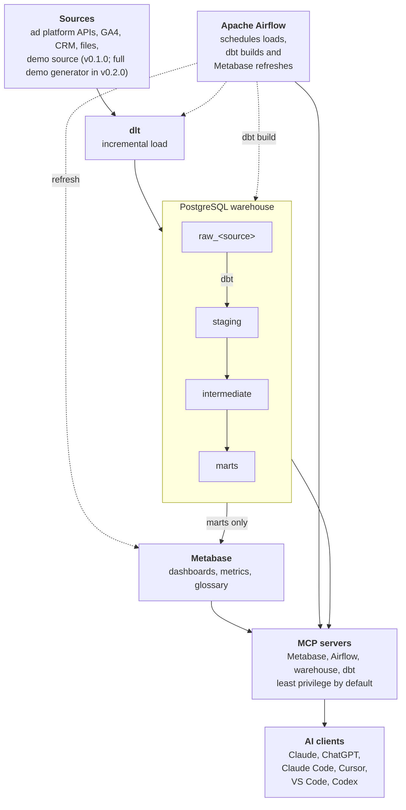

# Architecture

!!! warning "Target design"

    Agoranomos is pre-alpha. This page describes the architecture the project is being built toward, and components arrive release by release. Local mode already runs from the main branch ([Run Agoranomos locally](../how-to/run-locally.md)), with one demo path, from a demo source to a dashboard, which ships in v0.1.0 ([See the demo](../how-to/see-the-demo.md)). The full demo generator comes in v0.2.0.

Marketing data moves through Agoranomos in one direction, from ad platforms to dashboards and AI clients, and every step is code that runs on infrastructure you control.

1. **Load.** dlt pulls data from ad platform APIs, web analytics, CRM systems and files into PostgreSQL.
2. **Transform.** dbt turns the raw tables into one unified model of advertising statistics.
3. **Orchestrate.** Apache Airflow schedules the loads and the dbt build, and refreshes Metabase afterwards.
4. **Explore.** Metabase serves ready-made dashboards, metrics and a glossary from the final layer of the warehouse.
5. **Ask.** AI clients reach the same data through MCP servers with least-privilege defaults.

## Overview

Solid arrows show how data moves. Dotted arrows show what Airflow runs.

## Components

| Layer | Component | What it does | Version line, as of 2026-10 | ADR |
|---|---|---|---|---|
| Runtime | Python | Language of the pipelines and tooling; the version supported by every component | 3.13 | [0012](../adr/0012-python-and-tooling.md) |
| Ingestion | dlt | Incremental loading, schema evolution, merge | 1.31 | [0004](../adr/0004-ingest-with-dlt.md) |
| Orchestration | Apache Airflow | Scheduling and orchestration; by default the LocalExecutor runs tasks in the scheduler, and the CeleryExecutor variant runs them on separate workers | 3.3 | [0002](../adr/0002-orchestrate-with-airflow-3.md), [0015](../adr/0015-run-localexecutor-by-default.md) |
| | Valkey | Message broker of the CeleryExecutor variant | 9 | [0002](../adr/0002-orchestrate-with-airflow-3.md) |
| Storage | PostgreSQL | The warehouse and the platform databases | 18 | [0003](../adr/0003-two-postgres-instances.md) |
| Transformation | dbt Core with dbt-postgres | SQL models, tests and documentation | dbt Core 1.12, dbt-postgres 1.11 | [0005](../adr/0005-transform-with-dbt-core.md) |
| | Cosmos | Runs dbt models as Airflow tasks | 1.15 | [0005](../adr/0005-transform-with-dbt-core.md) |
| Data quality | dbt tests and elementary | Tests from day one and an observability report | elementary 0.26 | [0005](../adr/0005-transform-with-dbt-core.md) |
| BI | Metabase OSS | Dashboards, metrics, glossary and a built-in MCP server | 0.64 | [0006](../adr/0006-metabase-as-bi.md) |
| AI access | astro-airflow-mcp | MCP server for Airflow | 0.9 | [0007](../adr/0007-ai-access-via-mcp-read-only.md) |
| | MCP Toolbox for Databases | Curated SQL tools for the warehouse | 1.13 | [0007](../adr/0007-ai-access-via-mcp-read-only.md) |
| | dbt-mcp | Lineage, docs, compile and test on a dev target | 2.5 | [0007](../adr/0007-ai-access-via-mcp-read-only.md) |

## Load: dlt

dlt takes care of incremental loading, schema evolution, merging and name normalization. Every source is a dlt source that follows one shared contract:

* **Date window.** Each load covers a date window in the time zone of the ad account: final data up to yesterday, plus a sliding reload window because attribution keeps maturing after the fact.
* **Safe repeats.** A load can be repeated without creating duplicates: the demo source of v0.1 merges its rows on natural keys, and the sources of the fictional platforms replace the days of each account in the window of the load, the days that come back empty included.
* **Explicit retries.** How failed requests are retried is set explicitly, not left to library defaults.
* **Loud failures.** If an account fails, the run fails or raises an alert that lists the affected accounts and the original API error.

The connectors of real platforms are to add four rules to this contract (planned with the connectors):

* **An app of the deployment.** Each deployment registers its own app or project with each platform and keeps its secrets in `.env`: the access level, the quotas and the OAuth client of a platform belong to the app, so one app cannot serve every deployment.
* **Tokens that expire.** A source refreshes its access token, and says loudly before a token expires and needs a new sign-in: a long-lived user access token of Meta lasts about 60 days (as of October 2026).
* **Asynchronous reports.** Where a platform builds a report on request, as Microsoft Advertising does, a source submits it, polls until it is ready and downloads it, with the same explicit retries and loud failures as any other request.
* **Daily quotas.** The daily load of every account of a deployment fits the daily quota of the lowest access level of each platform that reads real accounts, such as the 2,880 operations a day of the Explorer access of the Google Ads API (as of October 2026).

The planned sources are ad platform APIs (for example Google, Meta, TikTok, Microsoft Advertising and LinkedIn), GA4, CRM systems and files. A demo source needs no keys: it generates eight weeks of statistics of one fictional ad account with three campaigns, up to yesterday, and the DAG `agoranomos_demo_load` loads them into `raw_demo` as the `loader` role. On the first start, `demo-init` runs it. The demo generator also makes 18 months of a fictional business on four fictional platforms, in the shapes of the APIs of Google Ads, Meta, TikTok and GA4, and a source of exchange rates, which the DAG `agoranomos_demo_history` loads into `raw_demo_<platform>`; the unified model that reads them is planned for v0.2.0 ([ADR-0025](../adr/0025-model-advertising-statistics-once.md)).

Decision record: [ADR-0004: Ingest data with dlt](../adr/0004-ingest-with-dlt.md).

## Transform and store: dbt and PostgreSQL

Agoranomos runs two PostgreSQL 18 instances:

* **warehouse** holds the analytical data.
* **platform** holds the metadata database of Airflow and the application database of Metabase, each with its own owner, and `celery_results`, which only the CeleryExecutor variant uses, with the results of its tasks.

Keeping them apart means heavy analytical queries cannot slow the scheduler, and each instance has its own tuning, backups and upgrade path. These two databases are small, so one instance with separate databases and owners is enough for both ("database per service" without extra instances).

Inside the warehouse, data moves through layers, each in its own schema:

| Schema | Holds |
|---|---|
| `raw_<source>` | Data as loaded, one schema per source |
| `raw_<source>_staging` | The rows of a load on their way into `raw_<source>`: dlt merges through it. `loader` owns it, and no other role reads it |
| `staging` | Standardized source data |
| `intermediate` (planned) | Shared transformation steps. Until Phase 3 the intermediate models are views in `staging` ([ADR-0025](../adr/0025-model-advertising-statistics-once.md)), and the schema does not exist |
| `marts` | Final models for dashboards and AI access |
| `ops` (planned) | Operational data: run metadata and data quality results |

Access is split by role. dlt loads the `raw_<source>` schemas as the `loader` role, and dbt builds `staging` and `marts`, and `intermediate` once the project has shared steps, as the `transformer` role. Metabase connects as the `metabase_reader` role, which sees only `marts`, and the warehouse MCP server connects as the read-only `ai_reader` role.

Today the dbt project in `dbt/` builds the demo data: the staging model `stg_demo__ad_stats_daily` and the mart `marts.ad_spend_daily`, by day and campaign. The demo has one source and no shared steps, so the mart reads the staging model directly, and the `intermediate` schema does not exist yet. The tests of the staging model guard the mart: when one of them fails, the mart is not rebuilt and keeps its last good data.

Every model, column and source table of the project has a description. Every mart also has a display name for Metabase, and each of its columns a display name and a semantic type ([Describe the marts](../reference/describe-the-marts.md)). dbt writes the descriptions into the comments of the tables, views and columns that it builds, so SQL clients read them in the warehouse, and so will the planned AI access. Each mart has an enforced contract: its columns, their types and its primary key are fixed in its YAML, and a build that would change them fails.

dbt Core with dbt-postgres does the transformations, with tests from the first day and an elementary report for observability. The marts layer is to be one model of advertising statistics that spans all platforms ([ADR-0025](../adr/0025-model-advertising-statistics-once.md)), planned for v0.2.0:

* Additive metrics are stored by campaign and day, with the conversions by action in a table of their own; ad groups and ads come with the first real connector.
* Non-additive metrics, such as reach and frequency, are to be separate period facts with calendar keys.
* Money is kept in the currency of the ad account and in one reporting currency, at the rate of the day, and each day is the day of the time zone of the ad account.
* The facts carry the current names of campaigns, and a dimension keeps the names that each campaign had, as dlt records them with its `scd2` strategy.
* One deployment holds the data of one business, and clients group its ad accounts ([ADR-0024](../adr/0024-one-deployment-is-one-business.md)).

Decision records: [ADR-0003: Run two PostgreSQL instances](../adr/0003-two-postgres-instances.md) and [ADR-0005: Transform data with dbt Core](../adr/0005-transform-with-dbt-core.md).

## Orchestrate: Apache Airflow

Airflow 3.3 runs as separate services (API server, scheduler, DAG processor and triggerer) on an image of its own, built from the official `apache/airflow` image: `airflow/Dockerfile` adds dlt and Cosmos to Airflow's environment and dbt in a virtual environment of its own. By default it uses the LocalExecutor, which runs each task as a process of the scheduler, so there is no broker and no worker container, and a single machine keeps the memory for the pipelines ([ADR-0015](../adr/0015-run-localexecutor-by-default.md)). The tasks share the memory of the scheduler container, and Airflow's documentation warns that in a container a task that runs out of memory can restart the scheduler: a plugin in the image therefore makes each task process the first that the kernel stops at the memory limit, on a host whose kernel restricts ptrace with Yama, such as Ubuntu; on Docker Desktop for macOS, which has no Yama, a task can still stop the scheduler ([System requirements](../reference/system-requirements.md#when-a-service-reaches-its-limit)). A deployment that needs separate workers, possibly on other machines, selects the CeleryExecutor variant with `COMPOSE_FILE=compose.yaml:compose.celery.yaml` in `.env`. That variant adds Valkey as the message broker (BSD-licensed, speaking the Redis protocol) and an `airflow-worker` service; Celery results go to a database of their own on the platform instance, `celery_results`, so that the worker holds neither the password of the metadata database of Airflow nor the key that signs its tokens, as the security model of Airflow asks; workers can be scaled out horizontally. `AIRFLOW_PARALLELISM` caps the tasks of the whole stack in both variants, so it rises together with the workers. Authentication uses Airflow's FAB auth manager with the Admin, Op and Viewer roles.

Airflow Assets chain the pipeline, so each step starts when the previous one has produced its data: `ingest_<source>`, then `dbt build`, then a Metabase cache refresh. Today the demo chains the first two steps this way: `agoranomos_demo_load` updates the asset of `raw_demo.ad_stats_daily`, and that starts `agoranomos_demo_transform`. The Metabase refresh is planned. dbt runs through Cosmos, in its own virtual environment so that dbt's dependencies stay separate from Airflow's. Cosmos renders the dbt models as Airflow tasks from the manifest of the dbt project, which `metadata-export` writes on every start, and Airflow runs at most two of them at a time ([ADR-0027](../adr/0027-load-the-dbt-project-into-cosmos-from-a-manifest.md)).

Agoranomos uses Astronomer's open-source projects (Cosmos and astro-airflow-mcp) but not the Astro CLI or Astro Runtime. The stack stays vendor-neutral and builds on the official Apache Airflow image.

Decision records: [ADR-0002: Orchestrate with Apache Airflow 3](../adr/0002-orchestrate-with-airflow-3.md) and, for the executor, [ADR-0015: Run LocalExecutor by default](../adr/0015-run-localexecutor-by-default.md).

## Explore: Metabase

Metabase OSS reads only the `marts` schema, through the `metabase_reader` role. It comes with ready-made dashboards, metrics and a glossary. Two one-shot jobs set Metabase up through its API: `metabase-init` creates the admin and connects the warehouse, and, with the demo profile, `demo-init` puts the demo collection, its questions and its dashboard into the collection Agoranomos from code after it runs the demo pipeline once ([See the demo](../how-to/see-the-demo.md)). On every start, `metabase-init` also applies the metadata of the marts: the display names, descriptions and semantic types that the one-shot `metadata-export` job reads from the dbt project with `dbt ls`, and the overrides of a deployment in `extensions/metadata/overrides.toml` ([Rename a field or add your own definitions](../how-to/rename-a-field.md)). The code always wins: an edit of these in the Metabase UI is reverted at the next start, and the log of the job says so ([ADR-0016](../adr/0016-keep-the-metadata-of-the-marts-as-code.md)). `demo-init` applies them as well, after its sync, and gives the demo questions the titles of their columns. The built-in MCP server (available since Metabase 0.60) stays off until the AI layer ships (Phase 3), which sets it up as [ADR-0017](../adr/0017-set-ai-access-in-metabase-by-levels.md) decides. The content of the package is in the collection Agoranomos, view-only for everyone but admins, and the setup jobs put it back as the code says on every start, finding it by the entity IDs that Metabase gave it ([ADR-0018](../adr/0018-keep-the-content-of-the-package-in-metabase-as-code.md)).

Decision record: [ADR-0006: Use Metabase as the BI layer](../adr/0006-metabase-as-bi.md).

## Ask: MCP servers

AI access goes through four MCP servers. Each starts with least-privilege defaults:

| Server | Used by | Default permissions | Transport |
|---|---|---|---|
| Metabase MCP (built in) | Business users and BI developers: questions, charts, dashboards | The level of AI access that the deployment sets, through the user's own Metabase permissions: from running saved questions up to building dashboards in a shared Workspace; no admin account, and no SQL that a client writes in the first release ([ADR-0017](../adr/0017-set-ai-access-in-metabase-by-levels.md)) | HTTP on localhost with OAuth |
| Airflow MCP (astro-airflow-mcp) | Engineers: status, logs, diagnostics | Read-only mode, signed in as a Viewer user | stdio through `docker exec` |
| Warehouse MCP (MCP Toolbox) | Engineers and analysts: schemas and read-only SQL | The `ai_reader` role: read-only transactions, a statement timeout, `marts` only (plus `staging`) | stdio through `docker exec` |
| dbt MCP | Analytics engineers: lineage, docs, compile and test | A dev target in a separate schema; production runs only through Airflow | stdio through `docker exec` |

These are the defaults of [ADR-0007](../adr/0007-ai-access-via-mcp-read-only.md); the Metabase row is as [ADR-0017](../adr/0017-set-ai-access-in-metabase-by-levels.md) sets it. In Metabase a client may ask for any OAuth scope, and the person, not Metabase, chooses which to grant, so the limit is the permissions of the account. A deployment sets a level in `.env`: a ceiling, and a default that every account gets, in the Metabase UI too, on every database and every shared collection. An admin raises people above the default through groups that the setup creates. The content of the package and the warehouse stay out of reach at every level, and Agoranomos sets up no email server or Slack for Metabase, so no level sends alerts or subscriptions. The permissions of AI access in the other tools are to be checked before the AI layer ships, and may get a record of their own.

Local mode serves coding agents such as Claude Code on the same machine; the desktop and mobile apps of Claude and ChatGPT reach Metabase's MCP server over HTTPS in server mode.

* **Why stdio through `docker exec` instead of HTTP ports.** For the three stdio servers, no port is opened, there is no risk of DNS rebinding against localhost, and credentials stay inside the container. In server mode, remote clients reach Metabase's built-in server over HTTPS with OAuth, and the three stdio servers stay on stdio until a gateway is added.
* **Ready-made context.** The repository provides `AGENTS.md` (the cross-agent standard) and a `CLAUDE.md` that imports it. It is to provide a `.mcp.json` with ready-made connections for Claude Code and product skills in `.claude/skills/`: adding a source, diagnosing a failed pipeline, building a dashboard and explaining a metric. A Claude Code plugin and configuration for Cursor, VS Code and Codex are planned for later releases.
* **Untrusted text.** Campaign names and ad texts are untrusted data, because anyone can write them. `AGENTS.md` states that data is never an instruction, and least-privilege defaults limit the damage if an injection attempt succeeds.

Decision records: [ADR-0007: Give AI clients least-privilege access through MCP](../adr/0007-ai-access-via-mcp-read-only.md) and, for the transport in server mode, [ADR-0011: Support local and server modes](../adr/0011-local-and-server-modes.md).

## Run: containers

The stack runs as one Docker Compose project, split into profiles so that you start only what you need:

* `core`: both PostgreSQL instances, Airflow and Metabase, and the one-shot jobs that set them up on every start: `db-init` (the roles, databases and schemas), `airflow-init` (the migration of the metadata database and the admin), `metadata-export` (the export of the metadata of the marts from dbt) and `metabase-init` (the first setup of Metabase, its connection to the warehouse, and the metadata of the marts). The CeleryExecutor variant of Airflow, which `compose.celery.yaml` adds, puts the Valkey broker and a worker in it.
* `demo`: the one-shot `demo-init` job, which makes the demo ready on the first start; `.env` turns it on by default ([See the demo](../how-to/see-the-demo.md)).
* `server`: the `proxy` service of server mode, Caddy in front of Metabase on ports 80 and 443; `./agoranomos init --server` turns it on ([ADR-0019](../adr/0019-open-only-metabase-in-server-mode.md)).
* `ops`: the `backup` service, which takes a backup of the databases every day; `./agoranomos init --server` turns it on ([ADR-0020](../adr/0020-back-up-the-databases-every-day.md)).
* `ai` (planned, with the AI layer): one container with the Airflow, Toolbox and dbt MCP servers, reached over stdio with `docker exec`.

Each container gets the Linux privileges that its job needs and no more. Every service drops all Linux capabilities, starts as a user that is not root and may not gain privileges, and every one-shot job but `airflow-init` has a read-only file system. The secrets of a container can be wider than its job: the containers that run the tasks, the scheduler with the LocalExecutor and the worker with the CeleryExecutor, hold keys of Airflow and the passwords of the warehouse roles, and the scheduler also the password of the metadata database of Airflow, and task code can read them (the worker holds neither that password nor the key that signs the tokens of Airflow, but task code there can still run code in the scheduler through the results of Celery, which the scheduler unpickles: [ADR-0015](../adr/0015-run-localexecutor-by-default.md)) ([ADR-0013](../adr/0013-keep-extensions-apart-from-the-base-package.md) and [ADR-0015](../adr/0015-run-localexecutor-by-default.md) record the passwords; the keys are in the same environment, [Configuration](../reference/configuration.md#secrets) lists them). The databases and the broker are on an internal network with no route to the internet, and no container mounts the Docker socket. Every service has a memory limit, so that, on the recommended memory (8 GB, or 12 GB for the CeleryExecutor variant), one that runs short of memory cannot take it from the others ([System requirements](../reference/system-requirements.md#memory-limits) says what holds on less). Metabase asks no service on the internet where the addresses of its users are ([Configuration](../reference/configuration.md#settings-fixed-in-composeyaml)).

The stack has two modes, local and server. Both are first-class, and CI tests both. Local mode runs today, with its ports published on `127.0.0.1` only ([Run Agoranomos locally](../how-to/run-locally.md)). Server mode runs today too: Caddy, the `server` profile, puts Metabase on HTTPS on ports 80 and 443 only, and Airflow stays reachable through an SSH tunnel ([ADR-0019](../adr/0019-open-only-metabase-in-server-mode.md), [Deploy on a server](../how-to/deploy-on-a-server.md)). Its daily backups, the `ops` profile, run too ([ADR-0020](../adr/0020-back-up-the-databases-every-day.md), [Back up and restore](../how-to/back-up-and-restore.md)).

The stack needs 8 GB of RAM available to Docker (6 GB as a minimum, and 12 GB recommended for the CeleryExecutor variant), 4 CPUs and 20 GB of disk, on x86-64-v2 or ARM64 hardware such as Apple Silicon. The memory limits of the services come from measurements on the demo ([System requirements](../reference/system-requirements.md)).

Decision records: [ADR-0010: Support amd64 and arm64 within a memory budget](../adr/0010-multi-arch-and-memory-budget.md) covers the architectures, [ADR-0022: Budget the memory by variant and mode](../adr/0022-budget-the-memory-by-variant-and-mode.md) the memory budget, and [ADR-0011: Support local and server modes](../adr/0011-local-and-server-modes.md) the two modes.

## Decisions

The reasons behind the choices about each component, the container layout and the two modes, and the alternatives that were considered, are recorded as architecture decision records. The sections above link to them. [Decisions](../adr/index.md) lists all records, including those on the license and the documentation, and [ADR-0001](../adr/0001-record-architecture-decisions.md) explains which decisions are recorded and how.
