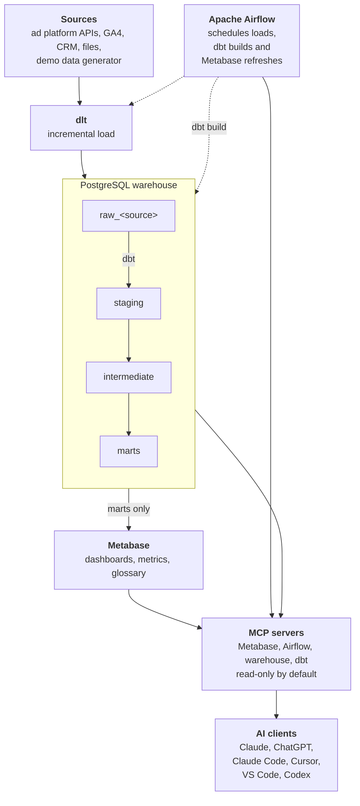

# Architecture

!!! warning "Target design"

    Agoranomos is pre-alpha. This page describes the architecture the project is being built towards, and components arrive release by release. You will be able to run the stack locally with demo data from v0.2.0; see [Tutorials](../tutorials/index.md).

Marketing data moves through Agoranomos in one direction, from ad platforms to dashboards and AI clients, and every step is code that runs on infrastructure you control.

1. **Load.** dlt pulls data from ad platform APIs, web analytics, CRM systems and files into PostgreSQL.
2. **Transform.** dbt turns the raw tables into one unified model of advertising statistics.
3. **Orchestrate.** Apache Airflow schedules the loads and the dbt build, and refreshes Metabase afterwards.
4. **Explore.** Metabase serves ready-made dashboards, metrics and a glossary from the final layer of the warehouse.
5. **Ask.** AI clients reach the same data through MCP servers that are read-only by default.

## Overview

Solid arrows show how data moves. Dotted arrows show what Airflow runs.

## Components

| Layer | Component | What it does | Version line, as of 2026-10 |
|---|---|---|---|
| Runtime | Python | Language of the pipelines and tooling; the version supported by every component | 3.13 |
| Ingestion | dlt | Incremental loading, schema evolution, merge | 1.30 |
| Orchestration | Apache Airflow with CeleryExecutor | Scheduling and orchestration; workers scale out | 3.3 |
| | Valkey | Message broker for Celery | 9 |
| Storage | PostgreSQL | The warehouse and the platform databases | 18 |
| Transformation | dbt Core with dbt-postgres | SQL models, tests and documentation | 1.12 and 1.11 |
| | Cosmos | Runs dbt models as Airflow tasks | 1.15 |
| Data quality | dbt tests and elementary | Tests from day one and an observability report | elementary 0.26 |
| BI | Metabase OSS | Dashboards, metrics, glossary and a built-in MCP server | 0.63 |
| AI access | astro-airflow-mcp | MCP server for Airflow | 0.9 |
| | MCP Toolbox for Databases | Curated SQL tools for the warehouse | 1.13 |
| | dbt-mcp | Lineage, docs, compile and test on a dev target | 2.5 |

## Load: dlt

dlt takes care of incremental loading, schema evolution, merging and name normalization. Every source is a dlt source that follows one shared contract:

* **Date window.** Each load covers a date window in the time zone of the ad account: final data up to yesterday, plus a sliding reload window because attribution keeps maturing after the fact.
* **Safe repeats.** Rows are merged on natural keys, so a load can be repeated without creating duplicates.
* **Explicit retries.** How failed requests are retried is set explicitly, not left to library defaults.
* **Loud failures.** If an account fails, the run fails or raises an alert that lists the affected accounts and the original API error.

The planned sources are ad platform APIs (for example Google, Meta, TikTok, Yandex and VK), GA4, CRM systems and files. A demo data generator produces realistic synthetic data for several fictional platforms. It needs no keys and fills the dashboards on first start.

## Transform and store: dbt and PostgreSQL

Agoranomos runs two PostgreSQL 18 instances:

* **warehouse** holds the analytical data.
* **platform** holds the Airflow and Metabase metadata databases, each with its own owner.

Keeping them apart means heavy analytical queries cannot slow the scheduler, and each instance has its own tuning, backups and upgrade path. The metadata databases are small, so one instance with separate databases and owners is enough for both ("database per service" without extra instances).

Inside the warehouse, data moves through layers, each in its own schema:

| Schema | Holds |
|---|---|
| `raw_<source>` | Data as loaded, one schema per source |
| `staging` | Standardized source data |
| `intermediate` | Shared transformation steps |
| `marts` | Final models for dashboards and AI access |
| `ops` | Operational data: run metadata and data quality results |

Access is split by role. dlt loads the `raw_<source>` schemas as the `loader` role, and dbt builds `staging`, `intermediate` and `marts` as the `transformer` role. Metabase connects as the `metabase_reader` role, which sees only `marts`, and the warehouse MCP server connects as the read-only `ai_reader` role.

dbt Core with dbt-postgres does the transformations, with tests from the first day and an elementary report for observability. The marts layer is a single advertising-statistics model that spans all platforms:

* Additive metrics are stored at daily grain: date, account, campaign, ad group and ad.
* Non-additive metrics, such as reach and frequency, are separate period facts with calendar keys.
* Currencies (FX rates) and time zones are explicit.
* History is tracked as slowly changing dimensions (dbt snapshots with explicit `check_cols`) only for attributes where it matters.

## Orchestrate: Apache Airflow

Airflow 3.3 runs with the CeleryExecutor on the official `apache/airflow` image: API server, scheduler, DAG processor, triggerer and workers. Valkey is the message broker (BSD-licensed, speaking the Redis protocol), Celery results go to the metadata database, and workers can be scaled out horizontally. Authentication uses Airflow's FAB auth manager with the Admin, Op and Viewer roles.

Airflow Assets chain the pipeline, so each step starts when the previous one has produced its data: `ingest_<source>`, then `dbt build`, then a Metabase cache refresh. dbt runs through Cosmos, which renders dbt models as Airflow tasks, in its own virtual environment so that dbt's dependencies stay separate from Airflow's.

Agoranomos uses Astronomer's open-source projects (Cosmos and astro-airflow-mcp) but not the Astro CLI or Astro Runtime. The stack stays vendor-neutral and runs on the official Apache Airflow image.

## Explore: Metabase

Metabase OSS reads only the `marts` schema, through the `metabase_reader` role. It comes with ready-made dashboards, metrics and a glossary. A one-shot init job sets Metabase up on first start through its API: it connects the warehouse, creates collections and dashboards from code, and enables the built-in MCP server (available since Metabase 0.60).

## Ask: MCP servers

AI access goes through four MCP servers. Each starts with least-privilege defaults:

| Server | Used by | Default permissions | Transport |
|---|---|---|---|
| Metabase MCP (built in) | Business users: questions, charts, dashboards | The user's own Metabase permissions; the SQL tool can be switched off | HTTP on localhost with OAuth |
| Airflow MCP (astro-airflow-mcp) | Engineers: status, logs, diagnostics | Read-only mode, signed in as a Viewer user | stdio through `docker exec` |
| Warehouse MCP (MCP Toolbox) | Engineers and analysts: schemas and read-only SQL | The `ai_reader` role: read-only transactions, a statement timeout, `marts` only (plus `staging`) | stdio through `docker exec` |
| dbt MCP | Analytics engineers: lineage, docs, compile and test | A dev target in a separate schema; production runs only through Airflow | stdio through `docker exec` |

* **Why stdio through `docker exec` instead of HTTP ports.** No port is opened, there is no risk of DNS rebinding against localhost, and credentials stay inside the container. HTTP with authentication and a gateway is planned for server and team deployments in a later release.
* **Ready-made context.** The repository provides `AGENTS.md` (the cross-agent standard) and a `CLAUDE.md` that imports it, a `.mcp.json` with ready-made connections for Claude Code, and product skills in `.claude/skills/`: adding a source, diagnosing a failed pipeline, building a dashboard and explaining a metric. A Claude Code plugin and configuration for Cursor, VS Code and Codex are planned for later releases.
* **Untrusted text.** Campaign names and ad texts are untrusted data, because anyone can write them. `AGENTS.md` states that data is never an instruction, and read-only access by default limits the damage if an injection attempt succeeds.

## Run: containers

The stack runs as one Docker Compose project, split into profiles so that you start only what you need:

* `core`: both PostgreSQL instances, the broker, Airflow and Metabase, plus the one-shot jobs that initialize them (database migrations, users and the first Metabase setup).
* `ai`: one container with the Airflow, Toolbox and dbt MCP servers, reached over stdio with `docker exec`.
* `flower`: Celery monitoring.

A reverse proxy with TLS for server deployments (the `server` profile) and scheduled backups (the `ops` profile) are planned for later releases.

Plan for 8 GB of RAM available to Docker (6 GB is the minimum), 4 CPUs and 20 GB of disk, on x86-64-v2 or ARM64 hardware such as Apple Silicon.

## Decisions

The reasons behind these choices, and the alternatives that were considered, are recorded as architecture decision records. See [Decisions](../adr/index.md); [ADR-0001](../adr/0001-record-architecture-decisions.md) explains which decisions are recorded and how.
